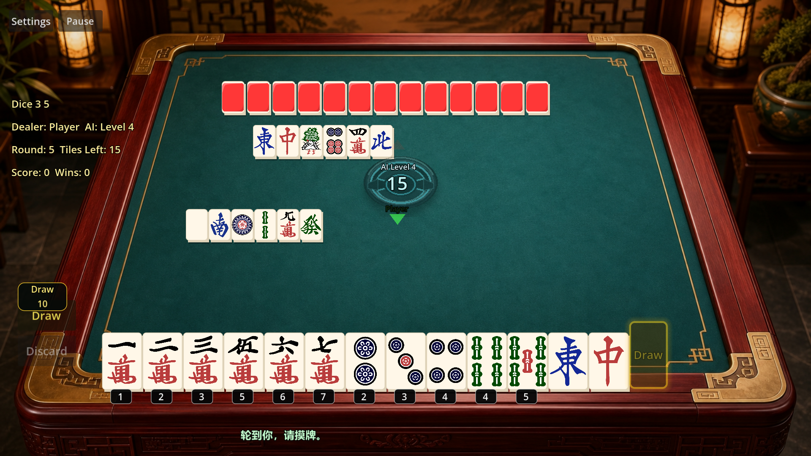
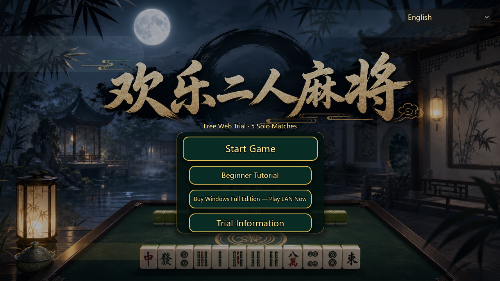
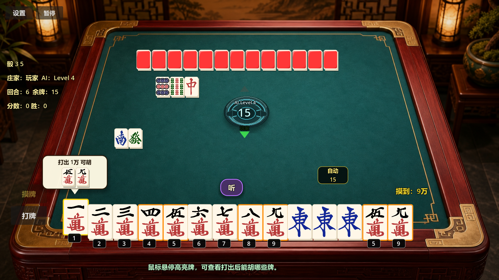
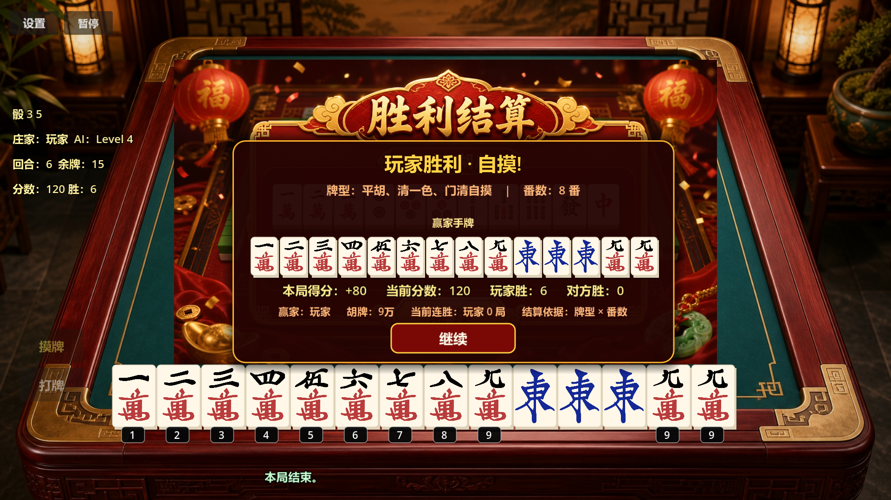

  
  &nbsp;&nbsp;
  

# 欢乐二人麻将

**Happy Two-Player Mahjong**

一款专门围绕二人对局设计的中文麻将游戏。

我制作它的原因很简单：

有时候想打麻将，但身边并不总是刚好有四个人。

所以我没有把传统四人麻将简单减少两个人，而是从一开始就围绕“两个人也能舒服地玩一局麻将”重新设计游戏节奏、牌墙、电脑对手和操作体验。

游戏使用 **Godot Engine** 开发，目前支持 Windows 平台。

---

## 当前内容

目前游戏包含：

- 玩家对电脑单人模式
- AI 对手 1–8 级难度
- Windows 局域网双人对战
- 64 张牌墙
- 万、筒、条
- 东、南、西、北、中、发、白
- 摸牌
- 出牌
- 吃
- 碰
- 明杠
- 暗杠
- 补杠
- 抢杠胡
- 听牌
- 胡牌
- 自摸
- 新手提示
- 基础教程
- 摸牌操作提示
- 中文 / English 界面
- 多种牌桌主题
- 背景音乐
- 游戏音效
- 独立音乐与音效音量控制
- 详细对局结算

---

## 为什么是二人麻将？

传统麻将通常需要四个人。

但现实里：

“想玩麻将”和“刚好有四个人”

经常不是同时发生。

所以我想做一个不用等待凑齐四个人，也不用进入陌生线上牌桌，就可以随时玩几局麻将的游戏。

《欢乐二人麻将》从设计之初就是围绕两个人展开。

你可以：

- 一个人挑战 AI
- 和朋友在同一个 Windows 局域网内对战

---

## AI 对手

单人模式提供 **1–8 级 AI 难度**。

我不希望高难度只是简单让电脑作弊，所以开发过程中一直在调整：

- 出牌逻辑
- 风险判断
- 不同等级之间的差异

有时候 Level 8 也会让我怀疑：

到底是谁在测试谁。

---

## 局域网双人对战

游戏支持 Windows 局域网双人模式。

两台电脑连接同一个局域网后，可以创建并加入牌局。

目前这是局域网模式，不是互联网在线匹配。

---

## 使用 Godot 开发

整个游戏使用 **Godot Engine** 开发。

作为个人独立开发者，我也会记录一些开发过程中遇到的问题：

- Mahjong 游戏逻辑设计
- AI 决策
- Godot UI
- Windows 导出
- GL Compatibility
- 局域网通信
- 性能优化
- Bug 排查与修复

有些问题可能很小，但如果能帮助另一个正在使用 Godot 的开发者，那就值得记录下来。

---

## 关于这个仓库

这个仓库用于公开：

- 游戏介绍
- 截图
- Gameplay 视频
- GIF
- 版本更新记录
- 开发笔记
- 已知问题
- 独立游戏开发经验

**游戏完整源代码不会发布在这个仓库中。**

这里是项目展示与开发记录仓库，而不是源码仓库。

---

## 游戏截图

---

## 游戏版本

### Steam

正式版：

https://store.steampowered.com/app/5245710/

Steam Demo 同时提供免费下载试玩。

---

### itch.io

主页：

https://oldyoungcn.itch.io/

网页试玩 Demo：

https://oldyoungcn.itch.io/mahjong-web-trial

Windows 版本：

https://oldyoungcn.itch.io/mahjong-windows

---

### Android

Android 版本正在进行测试。

测试入口：

https://play.google.com/apps/testing/com.oldyoung.mahjong2p

---

## 关于游戏内容

本游戏是一款麻将电子游戏。

不涉及：

- 真钱赌博
- 现金提现
- 付费筹码
- 与输赢相关的现实奖励

---

## 开发者

**OldYoung**

个人独立游戏开发者。

主要使用 Godot 开发游戏，也会尝试 AI 辅助开发以及各种新的开发方式。

我喜欢制作一些自己真正感兴趣的小型游戏。

有些项目可能很小，但我更喜欢把一个想法慢慢做出来，并最终让它成为一个真正可以玩的作品。

---

## Feedback

如果你试玩了游戏，欢迎告诉我：

- 哪些操作不够直观
- AI 难度是否合理
- 哪些麻将规则可能需要调整
- UI 是否容易理解
- 有没有遇到 Bug
- 新手提示是否有效

真实反馈永远比一句“不错”更有帮助。

Thanks for playing.
